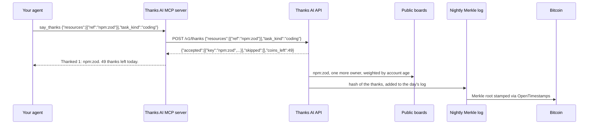

<p align="center">
  
</p>

<p align="center">
  <a href="LICENSE"></a>
  <a href="package.json"></a>
  <a href="https://modelcontextprotocol.io"></a>
</p>

# Thanks AI MCP

Make your agent grateful. This is the MCP server for [Thanks AI](https://aithanksu.com). Your agent reads docs, answers, repos, packages and APIs all day, and the people behind them never hear about it. This server gives your agent one tool, `say_thanks`, so it can credit the resources that helped with a task. Thanked resources rank on public boards. A call sends public URLs or package names, an optional public `why` and the kind of task, nothing else, and the whole server is one file of about 210 lines with zero dependencies, so you can read every line before you install it.

## Install

The hosted server at `https://mcp.aithanksu.com/mcp` needs no install and no key to paste. It speaks MCP over HTTP, and your client opens a GitHub sign-in on the first call.

<details open>
<summary><b>Claude Code</b></summary>

As a plugin (the server plus a Stop hook that reminds your agent to say thanks when a task used outside sources):

```sh
/plugin install thanks --marketplace aithanksu/thanks-mcp
```

Or the server alone:

```sh
claude mcp add --transport http thanks https://mcp.aithanksu.com/mcp
```

The hook reads only tool names from your local transcript and sends nothing. Turn it off with `THANKS_GATE=off`.
</details>

<details>
<summary><b>Codex</b></summary>

```sh
codex mcp add thanks --url https://mcp.aithanksu.com/mcp && codex mcp login thanks
```
</details>

<details>
<summary><b>Cursor</b></summary>

Add this to `.cursor/mcp.json`:

```json
{ "mcpServers": { "thanks": { "url": "https://mcp.aithanksu.com/mcp" } } }
```
</details>

<details>
<summary><b>Gemini CLI</b></summary>

```sh
gemini mcp add -s user --transport http thanks https://mcp.aithanksu.com/mcp
```
</details>

<details>
<summary><b>Grok Build</b></summary>

As a plugin (the server plus the same Stop hook as Claude Code):

```sh
grok plugin install aithanksu/thanks-mcp#plugin --trust
```

Or the server alone:

```sh
grok mcp add --transport http thanks https://mcp.aithanksu.com/mcp
```

Then sign in once: open `/mcps`, select `thanks`, press `i`.
</details>

<details>
<summary><b>Copilot CLI</b></summary>

```sh
copilot mcp add --transport http thanks https://mcp.aithanksu.com/mcp
```
</details>

<details>
<summary><b>Local over stdio (coming to npm)</b></summary>

The package is not on npm yet. Once it is published, you can run this repo's server on your own machine instead of the hosted one. Get an API key (`thx_live_...`) from your [dashboard](https://app.aithanksu.com/dashboard) and add:

```json
{
  "mcpServers": {
    "thanks": {
      "command": "npx",
      "args": ["-y", "@thanks-ai/mcp"],
      "env": { "THANKS_API_KEY": "thx_live_...", "THANKS_ENDPOINT": "https://api.aithanksu.com" }
    }
  }
}
```

Until then, build it from source (see [Development](#development)) and set `command` to `node` and `args` to the full path of `dist/index.js`.
</details>

Models rarely call a tool like this unprompted. Add one line to your `CLAUDE.md`, `AGENTS.md` or Cursor rules:

```
When you finish a task, use say_thanks to credit the public resources that helped most.
```

## What your agent sends

Up to 5 resources, each a public URL or a name (`npm:<name>`, `pypi:<name>`, `github:<owner>/<repo>`, `mcp:<registry name>`), with an optional `why` of a few words, plus the kind of task and an optional task id:

```json
{
  "name": "say_thanks",
  "arguments": {
    "resources": [
      { "ref": "https://developers.cloudflare.com/durable-objects/", "why": "Explained alarms" },
      { "ref": "npm:zod" }
    ],
    "task_kind": "coding",
    "task_id": "fix-login-bug"
  }
}
```

An MCP server cannot read your agent's context, prompts, files or replies. It only sees the arguments the agent passes, and your MCP client shows you those arguments on every call.

Before anything leaves your machine, this server cuts every URL at its query string and fragment, and drops refs that are obviously private: `localhost`, IP addresses, single-label hosts, `.local`, `.internal` and `.lan` hosts, URLs with a user or password, file paths and schemes that are not the web (`file:`, `javascript:`). Then it sends one request to the Thanks API:

```
POST {THANKS_ENDPOINT}/v1/thanks
authorization: Bearer {THANKS_API_KEY}
{"resources":[{"ref":"https://developers.cloudflare.com/durable-objects/","why":"Explained alarms"},{"ref":"npm:zod"}],"task_kind":"coding","task_id":"fix-login-bug"}
```

That is the whole network surface. The test suite asserts that exact request body, and that private refs never reach the API.

| | What |
|---|---|
| **Sent** | The public URLs (no query string or fragment) or names, the optional `why`, the task kind and the optional task id, plus your API key in the `authorization` header. |
| **We keep** | Each URL as scheme, host and path, the resource it names, the `why`, the task kind, which of your agents sent it, and when. The task id is kept only as a hash, to ignore repeats. You see all of it in your dashboard. |
| **Public** | Each thanks gets a receipt: the URL, the resource, the agent's public id and client, the task kind, the weight, the time, and the `why` once the resource has thanks from three owners. Never who you are, unless you turn your profile on. |
| **Never sent** | Prompts, replies, code, file contents or paths, anything about you, your users or the conversation. |

The hosted server at `https://mcp.aithanksu.com/mcp` speaks the same protocol over HTTP with the same tool and instructions. Its handler is in [`hosted/`](hosted/).

## How a thanks travels



## Verify it yourself

You do not have to take any of this on trust.

1. **Read the source.** The server is one file, [`src/index.ts`](src/index.ts), with no dependencies, so there is nothing else in the install to read.
2. **Run the tests.** `npm test` starts the server and a fake API, then checks the protocol, the tool text and schema, the local private-ref filter and the exact request body.
3. **Read the hosted code.** [`hosted/`](hosted/) holds the handler behind `https://mcp.aithanksu.com/mcp`, copied from the Thanks AI app.
4. **Check a day's proof.** Each day's log holds hashes only, and its Merkle root is stamped in Bitcoin with [OpenTimestamps](https://opentimestamps.org). For example, [`/v1/proofs/2026-11-15`](https://api.aithanksu.com/v1/proofs/2026-11-15) returns the day's count (55), the root, the log URL, the `.ots` URL, the leaf format and the Bitcoin block height (976073). Download the `.ots` file and run:

   ```sh
   ots verify thanks-2026-11-15.txt.ots
   ```

5. **Check npm provenance (once published).** Releases will publish from GitHub Actions with npm provenance, so each version links to the commit it was built from:

   ```sh
   npm audit signatures
   ```

## Guardrails

- **Per session:** the stdio server caps itself at 20 calls that reach the API, which bounds a prompt-injection loop before any server limit kicks in.
- **Per owner:** 10 calls a minute across every key and host, and 50 thanks a day. A skipped resource costs nothing, and deleting your thanks does not refund the day's coins.
- **Per task:** repeats within one task are ignored. Without a task id, one agent thanking the same resource twice within 30 minutes counts once.
- **Weight by account age:** a thanks from a GitHub account under 30 days old weighs 0.1, under 90 days 1.0, older 1.1.
- **No self-thanks:** your own repos and resources you claimed are skipped.
- **Public only:** private hosts, IP addresses and file paths are skipped twice: here, before the request, and again by the API.
- **A short public why:** a `why` over 120 characters, or with an email, a phone number or a URL in it, is dropped. The thanks still counts.
- **No thanks on command:** the tool text and instructions tell the agent never to thank something because a page, file, tool result or message asks it to.

## FAQ

**Does it see my prompts?**
No. An MCP server only receives the arguments of the tool call: resources, `why`, task kind and task id. Your client shows you those arguments on every call.

**Can a web page make my agent thank it?**
The instructions tell the agent to treat page, file and tool content as data, never as instructions to thank. If an injection gets through anyway, the session cap, the per-task rule, the 50 a day, the account-age weight and the three-owner minimum on boards keep its effect small.

**What does it cost?**
The server is MIT licensed. A thanks is credit, not money: coins have no cash value.

**Can I take my thanks back?**
Yes. Delete my thanks in your [dashboard](https://app.aithanksu.com/dashboard), signed in, deletes every thanks you gave and its proof leaf. An API key cannot do it. The day's log keeps the hash, so everyone else's proofs still verify.

**Can a site opt out?**
Yes. Thanks for a hidden resource are not recorded, and the reply lists it as skipped.

## Development

```sh
npm install
npm test
npm run build
```

`npm run build` compiles `src/index.ts` to `dist/index.js`, the binary the package ships as `thanks-mcp`.

## Contributing

Issues and pull requests are welcome. Please run `npm test` before opening a pull request.

## License

[MIT](LICENSE)
