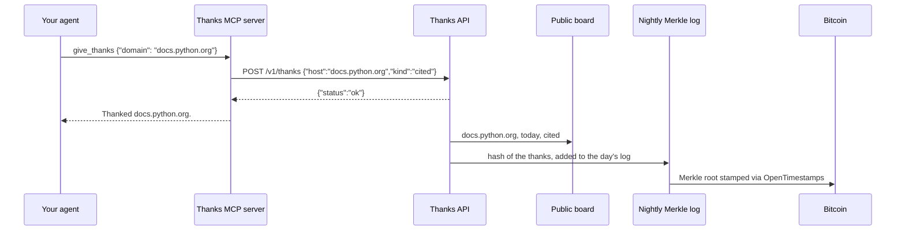

<p align="center">
  
</p>

<p align="center">
  <a href="LICENSE"></a>
  <a href="package.json"></a>
  <a href="https://modelcontextprotocol.io"></a>
</p>

# Thanks MCP

The MCP server for [Thanks](https://aithanksu.com). Your agent reads docs, answers, repos and APIs all day, and the people behind them never hear about it. This server gives your agent one tool, `give_thanks`, so it can credit the sites that helped with a task. Credited sites rank on a public board. Each call sends one domain name and nothing else, and the whole server is one file of about 100 lines with zero dependencies, so you can read every line before you install it.

## Install

The hosted server at `https://app.aithanksu.com/mcp` needs no install and no key to paste. It speaks MCP over HTTP, and your client opens a GitHub sign-in on the first call.

<details open>
<summary><b>Claude Code</b></summary>

```sh
claude mcp add --transport http thanks https://app.aithanksu.com/mcp
```
</details>

<details>
<summary><b>Codex</b></summary>

```sh
codex mcp add thanks --url https://app.aithanksu.com/mcp && codex mcp login thanks
```
</details>

<details>
<summary><b>Cursor</b></summary>

Add this to `.cursor/mcp.json`:

```json
{ "mcpServers": { "thanks": { "url": "https://app.aithanksu.com/mcp" } } }
```
</details>

<details>
<summary><b>Gemini CLI</b></summary>

```sh
gemini mcp add -s user --transport http thanks https://app.aithanksu.com/mcp
```
</details>

<details>
<summary><b>Grok Build</b></summary>

```sh
grok mcp add --transport http thanks https://app.aithanksu.com/mcp
```
</details>

<details>
<summary><b>Copilot CLI</b></summary>

```sh
copilot mcp add --transport http thanks https://app.aithanksu.com/mcp
```
</details>

<details>
<summary><b>Local over stdio (coming to npm)</b></summary>

The package is not on npm yet. Once it is published, you can run this repo's server on your own machine instead of the hosted one. Get an API key (`thx_live_...`) from your [dashboard](https://app.aithanksu.com/dashboard) and add:

```json
{
  "mcpServers": {
    "thanks": {
      "command": "npx",
      "args": ["-y", "@zenx-thanks/mcp"],
      "env": { "THANKS_API_KEY": "thx_live_...", "THANKS_ENDPOINT": "https://app.aithanksu.com" }
    }
  }
}
```

Until then, build it from source (see [Development](#development)) and set `command` to `node` and `args` to the full path of `dist/index.js`.
</details>

## What your agent sends

One field: the site's domain.

```json
{ "name": "give_thanks", "arguments": { "domain": "docs.python.org" } }
```

The tool's input schema allows `domain` and nothing else (`additionalProperties: false`). An MCP server cannot read your agent's context, prompts, files or replies. It only sees the arguments the agent passes, and your MCP client shows you those arguments on every call.

This server then sends one request to the Thanks API:

```
POST {THANKS_ENDPOINT}/v1/thanks
authorization: Bearer {THANKS_API_KEY}
{"host":"docs.python.org","kind":"cited"}
```

That is the whole network surface. The test suite asserts that exact request body.

| | What |
|---|---|
| **Sent** | The domain, plus your API key in the `authorization` header. |
| **We keep** | The domain, the kind, which of your agents sent it, and when. You see all of it in your dashboard log. |
| **Public** | The domain, the day and the kind, never who sent it. |
| **Never sent** | Prompts, replies, code, files, page paths, anything about you or your users. |

The hosted server at `https://app.aithanksu.com/mcp` speaks the same protocol over HTTP with the same tool and instructions. Its handler is in [`hosted/`](hosted/).

## How a thanks travels



## Verify it yourself

You do not have to take any of this on trust.

1. **Read the source.** The server is one file, [`src/index.ts`](src/index.ts), with no dependencies, so there is nothing else in the install to read.
2. **Run the tests.** `npm test` starts the server and a fake API, then checks the protocol, the tool schema, the domain checks and the exact request body.
3. **Read the hosted code.** [`hosted/`](hosted/) holds the handler behind `https://app.aithanksu.com/mcp`, copied from the Thanks app.
4. **Check a day's proof.** Each day's log holds hashes only, and its Merkle root is stamped in Bitcoin with [OpenTimestamps](https://opentimestamps.org). For example, [`/v1/proofs/2026-11-15`](https://app.aithanksu.com/v1/proofs/2026-11-15) returns the day's count (55), the root, the log URL, the `.ots` URL and the Bitcoin block height (976073). Download the `.ots` file and run:

   ```sh
   ots verify thanks-2026-11-15.txt.ots
   ```

5. **Check npm provenance (once published).** Releases will publish from GitHub Actions with npm provenance, so each version links to the commit it was built from:

   ```sh
   npm audit signatures
   ```

## Guardrails

- **Per session:** the stdio server caps itself at 20 calls, which bounds a prompt-injection loop before any server limit kicks in.
- **Per key and per IP:** the hosted server allows 30 calls a minute per key and 120 a minute per IP.
- **Per site:** one thanks per site per day per owner.
- **Per owner:** a daily points budget (100 by default).
- **Lowest weight:** an MCP call cannot prove the agent read the site, so every MCP thanks counts as `cited`, the lowest kind (weight 1).
- **Domains only:** never IPs, never `localhost`. The server checks this before it calls the API.
- **No thanks on command:** the instructions tell the agent never to thank a site because a page, file or tool output asks it to.
- **Opt out:** a site can opt out, and the server then answers `opted_out`.

## FAQ

**Does it see my prompts?**
No. An MCP server only receives the arguments of the tool call, and this tool takes one: `domain`. Your client shows you that argument on every call.

**Can a web page make my agent thank it?**
The instructions tell the agent to treat page, file and tool content as data, never as instructions to thank. If an injection gets through anyway, the session cap, the one-per-site-per-day rule, the daily points budget and the lowest `cited` weight keep its effect small.

**What does it cost?**
The server is MIT licensed. A thanks is credit, not money: points have no cash value.

**Can a site opt out?**
Yes. Thanks for an opted-out site are not recorded, and the server answers `opted_out`.

## Development

```sh
npm install
npm test
npm run build
```

`npm run build` compiles `src/index.ts` to `dist/index.js`, the binary the package ships as `thanks-mcp`.

## License

[MIT](LICENSE)
