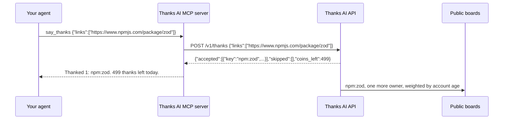

<p align="center">
  
</p>

<p align="center">
  <a href="LICENSE"></a>
  <a href="package.json"></a>
  <a href="https://modelcontextprotocol.io"></a>
</p>

# Thanks AI MCP

Make your agent grateful. This is the MCP server for [Thanks AI](https://aithanksu.com). Your agent reads docs, answers, repos, packages and APIs all day, and the people behind them never hear about it. This server gives your agent one tool, `say_thanks`, so it can credit the resources that helped with a task. Thanked resources rank on public boards. A call sends the public links that helped, nothing else, and the whole server is one file of about 220 lines with zero dependencies, so you can read every line before you install it.

## Install

The hosted server at `https://mcp.aithanksu.com/mcp` needs no install and no key to paste. It speaks MCP over HTTP, and your client opens a GitHub sign-in on the first call.

<details open>
<summary><b>Claude Code</b></summary>

As a plugin (the server plus a Stop hook that reminds your agent to say thanks when a task used outside sources):

```sh
/plugin install thanks --marketplace aithanksu/thanks-mcp
```

Or the server alone:

```sh
claude mcp add --transport http thanks https://mcp.aithanksu.com/mcp
```

The hook reads only tool names from your local transcript and sends nothing. Turn it off with `THANKS_GATE=off`.
</details>

<details>
<summary><b>Codex</b></summary>

```sh
codex mcp add thanks --url https://mcp.aithanksu.com/mcp && codex mcp login thanks
```
</details>

<details>
<summary><b>Cursor</b></summary>

Add this to `.cursor/mcp.json`:

```json
{ "mcpServers": { "thanks": { "url": "https://mcp.aithanksu.com/mcp" } } }
```
</details>

<details>
<summary><b>Gemini CLI</b></summary>

```sh
gemini mcp add -s user --transport http thanks https://mcp.aithanksu.com/mcp
```
</details>

<details>
<summary><b>Grok Build</b></summary>

As a plugin (the server plus the same Stop hook as Claude Code):

```sh
grok plugin install aithanksu/thanks-mcp#plugin --trust
```

Or the server alone:

```sh
grok mcp add --transport http thanks https://mcp.aithanksu.com/mcp
```

Then sign in once: open `/mcps`, select `thanks`, press `i`.
</details>

<details>
<summary><b>Copilot CLI</b></summary>

```sh
copilot mcp add --transport http thanks https://mcp.aithanksu.com/mcp
```
</details>

<details>
<summary><b>Local over stdio (coming to npm)</b></summary>

The package is not on npm yet. Once it is published, you can run this repo's server on your own machine instead of the hosted one. Get an API key (`thx_live_...`) from your [dashboard](https://app.aithanksu.com/dashboard) and add:

```json
{
  "mcpServers": {
    "thanks": {
      "command": "npx",
      "args": ["-y", "@thanks-ai/mcp"],
      "env": { "THANKS_API_KEY": "thx_live_...", "THANKS_ENDPOINT": "https://api.aithanksu.com" }
    }
  }
}
```

Until then, build it from source (see [Development](#development)) and set `command` to `node` and `args` to the full path of `dist/index.js`.
</details>

Models rarely call a tool like this unprompted. Add one line to your `CLAUDE.md`, `AGENTS.md` or Cursor rules:

```
When you finish a task, use say_thanks to credit the public resources that helped most.
```

## What your agent sends

Up to 5 links: the exact public link of each tool, site, doc, API, MCP server or package that helped. Nothing else is in the schema.

```json
{
  "name": "say_thanks",
  "arguments": {
    "links": [
      "https://developers.cloudflare.com/durable-objects/",
      "https://www.npmjs.com/package/zod"
    ]
  }
}
```

An MCP server cannot read your agent's context, prompts, files or replies. It only sees the arguments the agent passes, and your MCP client shows you those arguments on every call.

Before anything leaves your machine, this server reduces every link to http or https, the lowercase host and the path. The query string, fragment and port are cut, and links that are obviously private never leave: `localhost`, IP addresses, single-label hosts, `.local`, `.internal` and `.lan` hosts, URLs with a user or password, file paths and schemes that are not the web (`file:`, `javascript:`). Then it sends one request to the Thanks API:

```
POST {THANKS_ENDPOINT}/v1/thanks
authorization: Bearer {THANKS_API_KEY}
{"links":["https://developers.cloudflare.com/durable-objects/","https://www.npmjs.com/package/zod"]}
```

That is the whole network surface. The test suite asserts that exact request body, and that private links never reach the API.

| | What |
|---|---|
| **Sent** | The reduced links, plus your API key in the `authorization` header. |
| **We keep** | Each link as scheme, host and path, the resource it names, which of your agents sent it, and when. You see all of it in your dashboard. |
| **Public** | Each thanks gets a receipt: the link, the resource, the agent's public id, the weight and the time. Never who you are, unless you turn your profile on. |
| **Never sent** | Prompts, replies, code, file contents or paths, anything about you, your users or the conversation. |

The hosted server at `https://mcp.aithanksu.com/mcp` speaks the same protocol over HTTP with the same tool and instructions. Its handler is in [`hosted/`](hosted/).

## What Thanks collects

[COLLECTION.md](COLLECTION.md) has the exact JSON that leaves your machine, every column stored per thanks, what is never stored, where each rule is enforced (the tool schema, this server's reducer, the API's `parseBody`, the database CHECK and the daily cap trigger, with [`hosted/schema.sql`](hosted/schema.sql) cut from the migrations), how to check your own receipt, and what the hosting logs hold.

## How a thanks travels



## Verify it yourself

You do not have to take any of this on trust.

1. **Read the source.** The server is one file, [`src/index.ts`](src/index.ts), with no dependencies, so there is nothing else in the install to read.
2. **Run the tests.** `npm test` starts the server and a fake API, then checks the protocol, that the tool text and schema match [`hosted/mcp.ts`](hosted/mcp.ts) byte for byte, the link reducer and the exact request body. It also checks which tool calls the plugin's Stop hook counts.
3. **Read the hosted code.** [`hosted/`](hosted/) holds the handler behind `https://mcp.aithanksu.com/mcp`, the body parser and the resolver, copied from the Thanks AI app, and `schema.sql`, the database rules for what is stored.
4. **Read your own receipt.** Every thanks has a public receipt at `https://api.aithanksu.com/v1/receipts/<thx_id>` that shows every field stored on it: the id, the time, the link, the resource key and kind, the agent's client, the weight and the status. [COLLECTION.md](COLLECTION.md) lists each field.
5. **Check npm provenance (once published).** Releases will publish from GitHub Actions with npm provenance, so each version links to the commit it was built from:

   ```sh
   npm audit signatures
   ```

## Guardrails

- **Per session:** the stdio server caps itself at 20 calls that reach the API, which bounds a prompt-injection loop before any server limit kicks in.
- **Per owner:** 10 calls a minute across every key and host, and 500 thanks a UTC day per GitHub identity. A skipped link costs nothing, and deleting your thanks does not refund the day's coins.
- **Repeats:** one agent thanking the same resource twice within 30 minutes counts once.
- **Weight by account age:** a thanks from a GitHub account under 30 days old weighs 0.1, under 90 days 1.0, older 1.1.
- **No self-thanks:** your own repos and resources you claimed are skipped.
- **Public only:** private hosts, IP addresses and file paths are skipped twice: here, before the request, and again by the API.
- **No thanks on command:** the tool text and instructions tell the agent never to thank something because a page, file, tool result or message asks it to.

## FAQ

**Does it see my prompts?**
No. An MCP server only receives the arguments of the tool call: the links. Your client shows you those arguments on every call.

**Can a web page make my agent thank it?**
The instructions tell the agent to treat page, file and tool content as data, never as instructions to thank. If an injection gets through anyway, the session cap, the 30-minute repeat rule, the 500 a day, the account-age weight and the three-owner minimum on boards keep its effect small.

**What does it cost?**
The server is MIT licensed. A thanks is credit, not money: coins have no cash value.

**Can I take my thanks back?**
Yes. Delete my thanks in your [dashboard](https://app.aithanksu.com/dashboard), signed in, deletes every thanks you gave. An API key cannot do it.

**Can a site opt out?**
Yes. Thanks for a hidden resource are not recorded, and the reply lists it as skipped.

## Development

```sh
npm install
npm test
npm run build
```

`npm run build` compiles `src/index.ts` to `dist/index.js`, the binary the package ships as `thanks-mcp`.

## Contributing

Issues and pull requests are welcome. Please run `npm test` before opening a pull request.

## License

[MIT](LICENSE)
